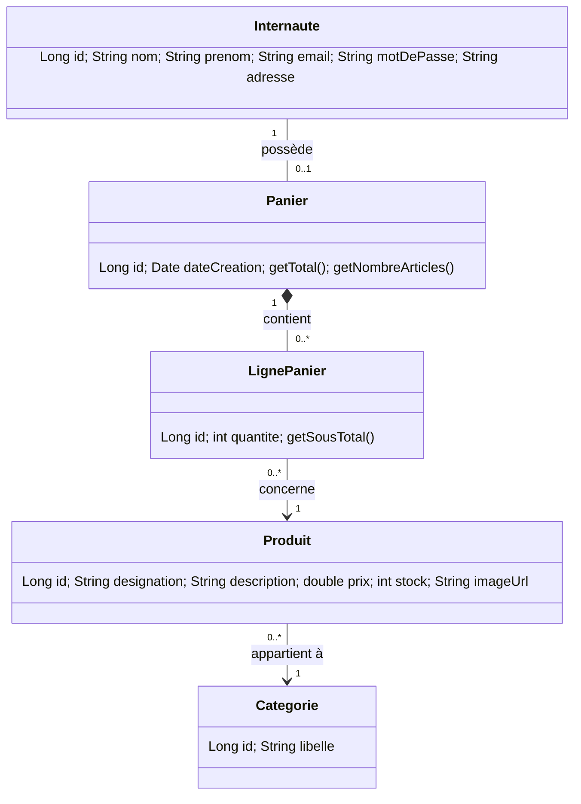

# Mini-rapport — Application web e-Commerce basée sur MVC2 et JPA

**Module :** JEE — Cycle Ingénieur LSI — FST Tanger — Pr. ELAACHAK Lotfi

## 1. Objectif
Maîtriser l'API JPA via une application e-commerce dont le contrôleur suit le patron **MVC 2** : une seule servlet par gestion, avec plusieurs actions (`?action=...`).

## 2. Outils
Eclipse, Maven, Tomcat 9, MySQL, JPA 2.2 (EclipseLink 2.7.5), JSP + JSTL, jQuery.

## 3. Étape 1 — Diagramme de classes

(Vitrine = catalogue des `Produit` filtrable par `Categorie`.)

## 4. Étape 2 — Projet Maven
Projet Web dynamique (Servlet 4.0) converti en Maven (`packaging=war`). Dépendances : `mysql-connector-java 8.0.12`, `eclipselink 2.7.5` (qui apporte `javax.persistence`), `jstl 1.2`, `servlet-api` (provided).

Corrections par rapport à l'énoncé : balises `</dependency>` / `<artifactId>` mal formées dans le 3ᵉ bloc, et suppression de `javax.persistence 2.0.0` qui entre en conflit avec EclipseLink 2.7.5 (JPA 2.2).

## 5. Étape 3 — Couche modèle / persistance
- Entités : `Internaute`, `Categorie`, `Produit`, `Panier`, `LignePanier` (`@Entity`, relations `@OneToOne`, `@OneToMany`, `@ManyToOne`).
- `META-INF/persistence.xml` : unité `ecommercePU`, `RESOURCE_LOCAL`, `eclipselink.ddl-generation=create-or-extend-tables` → la base `ecommerce_db` et ses tables sont **générées automatiquement** au premier démarrage (`createDatabaseIfNotExist=true`).
- `JPAUtil` : `EntityManagerFactory` unique ; chaque DAO/service ouvre un `EntityManager` et gère sa **transaction JPA** (`begin/commit/rollback`).
- Couches : `GenericDao<T>` → `InternauteDao`, `ProduitDao`, `CategorieDao` → services.
- `AppListener` insère des données de démonstration si la base est vide.

## 6. Étape 4 — Contrôleurs MVC 2
| Servlet | Actions |
|---|---|
| `ProduitServlet` | lister, detail, nouveau, editer, enregistrer, supprimer |
| `InternauteServlet` | formLogin, connecter, formInscription, inscrire, deconnecter, profil, modifier, supprimer |
| `PanierServlet` | afficher, ajouter, modifier, retirer, vider |

Flux : requête → servlet (switch sur `action`) → service/DAO (JPA) → attribut de requête → `forward` vers une JSP dans `WEB-INF/jsp` (vue). Redirection (PRG) après chaque modification.
Injection : `ServiceFactory` construit DAO → services (injection par constructeur) et les fournit aux servlets.

## 7. Vues
JSP avec **JSTL** (`c:forEach`, `c:choose`, `fmt:formatNumber`) et EL, sans scriptlet. **jQuery** : confirmation de suppression, vérification du mot de passe à l'inscription.

## 8. Exécution
1. Démarrer MySQL (adapter user/mot de passe dans `persistence.xml`).
2. `mvn clean package` puis déployer `target/ecommerce.war` sur Tomcat 9 (ou *Run on Server* sous Eclipse).
3. Ouvrir `http://localhost:8080/ecommerce/`.

## 9. Conclusion et limites
JPA permet de manipuler la base via des objets et de générer le schéma automatiquement. Améliorations possibles : rôles (admin), validation de commande, vérification du stock, pagination, upload d'images.
